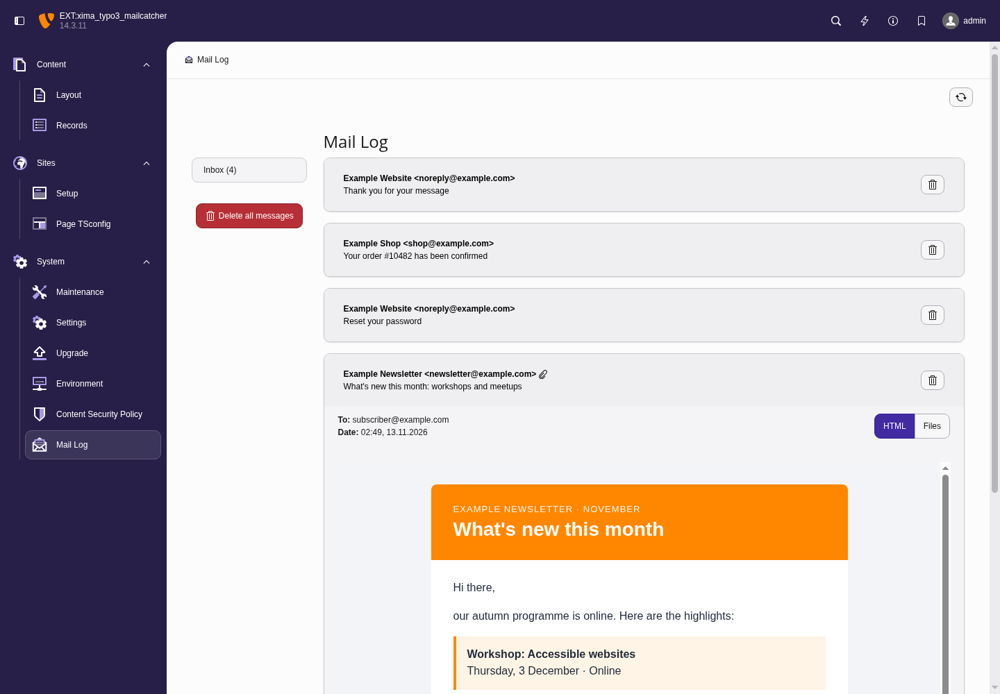

<div align="center">


# TYPO3 extension `xima_typo3_mailcatcher`


[](https://extensions.typo3.org/extension/xima_typo3_mailcatcher)

[](https://github.com/xima-media/xima-typo3-mailcatcher/actions/workflows/tests.yml)
[](https://codecov.io/gh/xima-media/xima-typo3-mailcatcher)


</div>

A TYPO3 extension that adds a backend module to view emails that were sent to
file. With the `mbox` mail transport, TYPO3 writes outgoing emails to a log file
instead of sending them. This extension reads that file and shows the emails in
the backend, which is handy on development and staging systems.



## Features

* Backend module **System → Mail Log**, available as soon as the `mbox`
  transport is active
* List of all caught emails, newest first, with sender, subject and an
  attachment indicator
* Detail view with recipient, Cc and date
* Switch between the plain text and the HTML version; HTML is rendered in an
  iframe, inline (`cid:`) images are resolved
* Download attachments
* Delete single emails or all at once

## Requirements

* TYPO3 12.4, 13.4 or 14.3
* PHP 8.1+

## Installation

```bash
composer require xima/xima-typo3-mailcatcher
```

Or download the extension from the
[TYPO3 Extension Repository (TER)](https://extensions.typo3.org/extension/xima_typo3_mailcatcher).

## Configuration

No extension configuration needed!

Change the mail transport to `mbox` (see the official
[TYPO3 Mail API](https://docs.typo3.org/m/typo3/reference-coreapi/main/en-us/ApiOverview/Mail/Index.html#mbox)),
e.g. in `config/system/additional.php`. TYPO3 then writes outgoing emails to
the file set in `transport_mbox_file`. The path must be absolute.

```php
$GLOBALS['TYPO3_CONF_VARS']['MAIL']['transport'] = 'mbox';
$GLOBALS['TYPO3_CONF_VARS']['MAIL']['transport_mbox_file'] = \TYPO3\CMS\Core\Core\Environment::getVarPath() . '/log/mail.log';
```

When the module is opened, it moves the emails from the log file to
`public/typo3temp/assets/xima_typo3_mailcatcher/`. Attachments are stored there
as well, so they are publicly accessible.

## Development

The repository ships a [DDEV](https://ddev.com) setup. `ddev init-typo3` sets up
a TYPO3 instance with the `mbox` transport (backend login `admin` / `Passw0rd!`):

```bash
ddev start
ddev composer install
ddev init-typo3
```

Run the checks and tests:

```bash
ddev composer ci:sca
ddev composer test:unit
ddev composer test:functional
ddev playwright test
```

## License

This project is licensed
under [GNU General Public License 2.0 (or later)](LICENSE.md).
